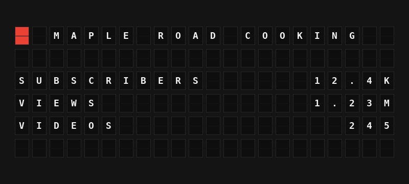

# YouTube Stats Plugin

Show a YouTube channel's subscribers, total views and video count on your board.



**→ [Setup Guide](./docs/SETUP.md)**

## Overview

YouTube Stats asks the YouTube Data API v3 for one channel's public statistics and shows them on your board, in short form (12.4K, 1.23M) or in full. It works with any public channel, by handle (`@name`) or channel ID, and needs only your own free API key: there is no sign-in.

## Template Variables

### Channel

| Variable | Description | Example |
|----------|-------------|---------|
| `{{youtube_stats.channel_name}}` | The channel's title | `MAPLE ROAD COOKING` |
| `{{youtube_stats.handle}}` | The channel's handle (empty when it has none) | `@MAPLEROADCOOKING` |
| `{{youtube_stats.logo_tile}}` | A red tile for decorating a line | `{63}` |

### Statistics

| Variable | Description | Example |
|----------|-------------|---------|
| `{{youtube_stats.subscribers}}` | Subscribers, short form; `HIDDEN` when the channel hides them | `12.4K` |
| `{{youtube_stats.subscribers_exact}}` | Subscribers with thousands separators (YouTube already rounds this to 3 significant figures) | `12,400` |
| `{{youtube_stats.subscribers_hidden}}` | `YES` when the channel hides its subscriber count, otherwise `NO` | `NO` |
| `{{youtube_stats.views}}` | Total views, short form | `1.23M` |
| `{{youtube_stats.views_exact}}` | Total views with thousands separators | `1,234,567` |
| `{{youtube_stats.videos}}` | Public videos, short form | `245` |
| `{{youtube_stats.videos_exact}}` | Public videos with thousands separators | `245` |
| `{{youtube_stats.subscribers_line}}` | Subscribers on one line | `12.4K SUBSCRIBERS` |
| `{{youtube_stats.views_line}}` | Views on one line | `1.23M VIEWS` |
| `{{youtube_stats.videos_line}}` | Videos on one line | `245 VIDEOS` |

## Example Templates

Flagship, centered:

```jinja
{{youtube_stats.logo_tile}} {{youtube_stats.channel_name}}

{{youtube_stats.subscribers_line}}
{{youtube_stats.views_line}}
{{youtube_stats.videos_line}}

```

Note:

```jinja
{{youtube_stats.logo_tile}} {{youtube_stats.channel_name}}
{{youtube_stats.subscribers}} SUBS
{{youtube_stats.views_line}}
```

## Configuration

| Setting | Type | Default | Description |
|---------|------|---------|-------------|
| `enabled` | boolean | `false` | Turn the plugin on |
| `api_key` | string | (required) | Your YouTube Data API v3 key, from your own Google Cloud project |
| `channel` | string | (required) | Channel handle (`@name`) or channel ID (`UC...`); a channel URL works too |
| `refresh_seconds` | integer | `1800` | How often to ask YouTube, 300 to 86400 seconds. Each check costs 1 of the key's 10,000 free daily quota units |

## Features

- Any public channel, by handle, channel ID or channel URL
- Short numbers (12.4K, 1.23M, 2.5B) that fit a Note, plus exact figures
- Handles channels that hide their subscriber count
- One quota unit per check, shared between all your boards; a 30-minute refresh uses 48 units a day
- Keeps showing the last numbers through a brief outage or after the daily quota runs out
- Clear messages for a wrong key, a disabled API, key restrictions and unknown channels
- Default layout when no template is set, for Flagship and Note boards

## Author

FiestaBoard Team
